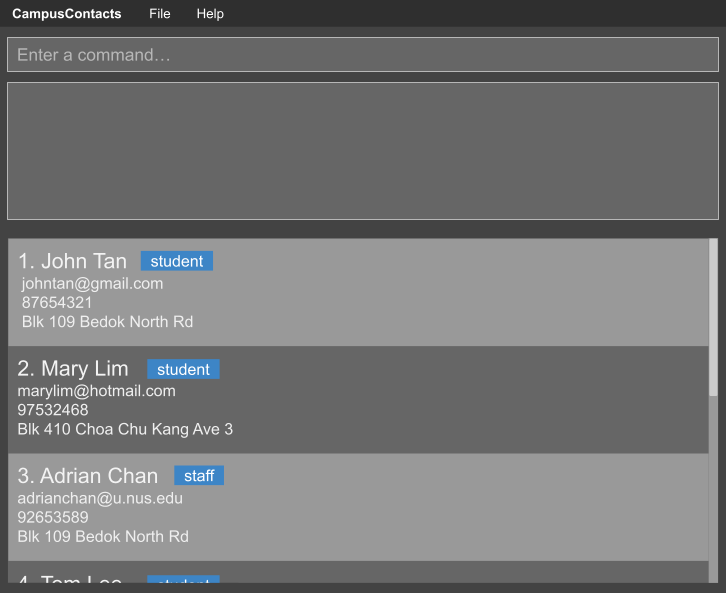

# CampusContacts User Guide

CampusContacts is a desktop application for managing contacts in the university community, optimized for use through a Command Line Interface (CLI) while retaining the benefits of a Graphical User Interface (GUI). If you type quickly, CampusContacts can help you manage contacts faster than traditional GUI applications.

<!-- * Table of Contents -->
<page-nav-print />

---

## Quick start

1. Ensure that Java `25` or later is installed on your computer. 
   **Mac users:** Ensure you have the precise JDK version prescribed [here](https://se-education.org/guides/tutorials/javaInstallationMac.html).

1. Download the latest `.jar` file from [here](https://github.com/AY2627S1-CS2103T-W14-1/tp/releases).

1. Copy the file to the folder you want to use as the _home folder_ for CampusContacts.

1. Open a terminal, `cd` to the folder containing the JAR file, and run `java -jar campuscontacts.jar`. 
   A GUI similar to the one below should appear in a few seconds. Note how the app contains some sample data. 
   

1. Type a command in the command box and press Enter to execute it. For example, type **`help`** and press Enter to open the help window. 
   Some example commands you can try:
   - `list` : Lists all contacts.

   - `add John Doe /email johnd@example.com /phone 98765432 /location John street, block 123, #01-01 /photo C:\Users\Student\Pictures\john.jpg` : Adds a contact named `John Doe` with an optional photo.

   - `show John Doe` : Opens John Doe's full contact details.

   - `delete John Doe` : Deletes John Doe from the contact list.

   - `clear` : Deletes all contacts.

   - `exit` : Exits the app.

1. Refer to the [Features](#features) section below for details of each command.

---

## Features

<box type="info" seamless>

**Notes about the command format:** 

- Words in `UPPER_CASE` are the parameters to be supplied by the user. 
  For example, in `add NAME /email EMAIL /phone PHONE /location LOCATION`, replace `NAME` with `John Doe`.

- Items in square brackets are optional. 
  For example, `[t/TAG]` means that a tag such as `t/friend` may be supplied or omitted.

- Items followed by `...` can appear zero or more times. 
  For example, `[t/TAG]... ` may be omitted, or written as `t/friend` or `t/friend t/family`.

- Prefixed fields can be in any order. For `add`, the name must come before all prefixed fields. 
  For example, `add John Doe /phone 98765432 /location COM1 /email johnd@example.com` is also acceptable.

- Extraneous parameters for commands that take no parameters, such as `help`, `list`, `exit`, and `clear`, are ignored. 
  For example, `help 123` is interpreted as `help`.

- If you are using a PDF version of this document, be careful when copying and pasting commands that span multiple lines as space characters surrounding line-breaks may be omitted when copied over to the application.
  </box>

### Viewing help: `help`

Opens an in-app guide containing the available commands and examples.

Format: `help`

### Adding a person: `add`

Adds a person to the contact list.

Format: `add NAME /email EMAIL /phone PHONE /location LOCATION [/photo FILE_PATH] [t/TAG]...`

- The name, email, phone number, and location are all required and must not be blank.
- Write the name first, without an `n/` prefix. The remaining fields may appear in any order.
- Separate `/email`, `/phone`, and `/location` from their values with a space.
- Each of these three prefixes must appear exactly once; repeated prefixes are rejected, even with identical values.
- Location is stored in the existing address field. It may contain spaces and punctuation.
- `/photo` is optional. Its value must be the path to a readable PNG, JPG, JPEG, or GIF file.
- CampusContacts copies the selected image into its own data folder. You may safely move or delete the original image after adding the contact.
- When different contacts use the same source image, CampusContacts saves separate copies for them.
- Tags are optional and use the `t/TAG` syntax.

If a contact already has the same name, CampusContacts assigns it a distinct display suffix. For example, adding a second `John Tan` displays it as `John Tan_2`.

<box type="tip" seamless>

**Tip:** A person can have any number of tags, including zero.
</box>

Examples:

- `add John Doe /email johnd@example.com /phone 98765432 /location COM1, #02-01`
- `add Betsy Crowe /location COM2 /phone 1234567 /email betsycrowe@example.com t/friend`
- `add Alex Tan /email alex@u.nus.edu /phone 91234567 /location COM1 /photo C:\Users\Student\Pictures\alex.jpg`

### Listing all persons: `list`

Shows a list of all persons in the contact list.

Format: `list`

### Managing favourite contacts: `favourite`, `unfavourite`, `favourites`

Mark people you contact often so you can find them quickly.

Formats:

- `favourite NAME[_NUMBER]`
- `unfavourite NAME[_NUMBER]`
- `favourites` (no arguments)

Use the same name/suffix identifiers as `show`, not a row number. Names are case-insensitive.
Omitting the suffix selects the unsuffixed contact, not every contact with that name.
Marking or unmarking works across the whole address book, even if the contact is hidden by the current filter.
Marking a contact reports `Added to favourites`; unmarking it reports `Removed from favourites`.
Repeating either command leaves the contact in the same state and reports `Already in favourites`
or `Not in favourites`, respectively.
An unknown name or suffix reports an error without changing favourites.

`favourites` replaces the current filter and displays favourite contacts in your selected `sort` order.
If there are none, the feedback explains how to mark one. Unmarking a contact while viewing favourites
removes it from the list immediately. Use `list` to show all contacts again. Adding a contact also returns
to the full list. After a restart, all contacts are shown until you run `favourites` again.

Examples (after adding two contacts named John Tan):

- `favourite John Tan_2` marks only the suffixed contact.
- `favourites` shows your favourite contacts.
- `unfavourite John Tan_2` removes that selection.

Favourites are saved automatically with your contacts. Deleting a contact also removes it from favourites;
a new contact using the same name and suffix starts unmarked. Confirmed `clear` removes all selections;
cancelling `clear` leaves them unchanged. If you manually remove a contact from the data file,
references to that missing contact in `favouriteContacts` are ignored when loading.

### Sorting persons: `sort`

Sorts the displayed persons by name or phone number.

Format: `sort FIELD [asc|desc]`

- `FIELD` must be `name`, `phone`, `add` or `edit`.
- The sort direction defaults to ascending.
- Sorting changes the displayed order only and does not change the saved address-book data.
- Specifically, when using `sort name desc`, the indices following the name are also placed in reverse order.

Examples:

- `sort name` sorts contacts alphabetically by name.
- `sort phone desc` sorts contacts by phone number in descending order.
- `sort name desc` applied to `[Alice, Alice_2, Bob]` displays `[Bob, Alice_2, Alice]`.
- `sort edit` effectively pushes last edited person to the top of the list.

### Editing a person: `edit`

Edits an existing person in the contact list.

Format: `edit INDEX [/name NAME] [/phone PHONE] [/email EMAIL] [/location LOCATION] [/major MAJOR] [/year YEAR] [/faculty FACULTY] [/department DEPARTMENT] [/hours HOURS] [/photo FILE_PATH or [blank]] [t/TAG or /tag TAG]...`

- Edits the person at the specified `INDEX`. The index refers to the index number shown in the displayed person list. The index **must be a positive integer** 1, 2, 3, ...
- At least one of the optional fields must be provided.
- Existing values will be updated to the input values.
- When editing tags, all of the person's existing tags are removed; adding tags is not cumulative.
- To remove all of a person's tags, enter `t/` without a tag after it.
- Use `/photo FILE_PATH` to add or replace a contact photo. Use `/photo [blank]` to remove it.
- Renaming a contact assigns the smallest available suffix for the new name. If that name already exists, the contact is added under the next available suffix.

Examples:
* `edit 1 /phone 91234567 /email johndoe@example.com` Edits the phone number and email address of the 1st contact.
* `edit 2 /name Betsy Crower t/` Edits the name of the 2nd contact to be `Betsy Crower` and clears all existing tags.
* `edit 1 /location UTown Residence` Edits the location of the 1st contact.

### Showing a contact's details: `show`

Opens a popup containing a contact's display name, contact ID, phone number, email, location, tags, and photo when one was added.

Format: `show NAME[_NUMBER]`

- Use the contact's displayed name.
- The optional `_NUMBER` identifies a particular contact when several contacts have the same name.
- If the suffix is omitted, CampusContacts selects the unsuffixed contact.

Examples:

- `show John Tan` opens details for the unsuffixed John Tan.
- `show John Tan_2` opens details for the second displayed John Tan.

### Returning to recently viewed contacts: `recent`

Format: `recent` (no arguments)

Shows the last ten different contacts opened with `show NAME[_NUMBER]`, most recent first.
Opening the same contact again moves it to the front; opening an eleventh distinct contact removes the oldest
from history, not from the address book. If `show` cannot find the contact, history stays unchanged. A save error also leaves
history unchanged and prevents the popup from opening. Running `recent`, `list` or `sort` does not count as a visit.

`recent` replaces the current filter and temporarily uses history order rather than your selected sort.
Reopening a contact while viewing `recent` immediately moves it to the front. `list` returns to all contacts
in your saved sort order; adding a contact also returns to all contacts. `sort FIELD [asc|desc]` sorts the
currently displayed matches as usual; run `recent` again to restore latest-first order.
As with the existing `show` command, only contacts in the currently displayed list can be opened:
run `list` first if the contact you want is hidden.

History is saved automatically with your contacts. After a restart, run `recent` to see it again.
Deleting a contact removes it from history. A new contact using the same name and suffix starts without
a visit. Confirmed `clear` also clears history; cancelling it does not. Older data files start with
empty history. If you manually edit `recentContacts` in the data file, stale references and repeats are
discarded and only the first ten distinct existing identifiers are retained.

Example (with both contacts already saved):

1. `list`
1. `show John Tan`
1. Close the popup, then `show John Tan_2`.
1. Close the popup, then `recent`: John Tan_2 appears before John Tan.
1. `show John Tan`, close the popup, then `recent`: John Tan is now first, with no duplicate entry.

An empty history displays a message explaining how to open a contact with `show`.

### Finding contacts: `find`

Finds contacts whose details match the specified keywords (case-insensitive substring match).

Format: `find [/name NAME] [/role ROLE] [/phone PHONE] [/email EMAIL] [/location LOCATION] [/major MAJOR] [/year YEAR] [/faculty FACULTY] [/department DEPARTMENT] [/hours HOURS] [t/TAG or /tag TAG]...`

* The search is case-insensitive (e.g. `john` matches `John`).
* Substring matching is supported (e.g. `COM` matches `COM1`, `ali` matches `Alice`, `@u.nus` matches email).
* If multiple different fields are specified, only contacts matching **all** criteria will be returned.
* If multiple keywords are given for the same field, contacts matching **any** of the keywords will be returned.
* You can search by name directly without prefix (e.g. `find Alice Bob`) or with `/name Alice`.

Examples:
* `find John` returns all contacts whose names contain `john`.
* `find /location COM1` returns all contacts located in COM1.
* `find /phone 9876 /email u.nus.edu` returns contacts matching both phone and email domain.
* `find /role student /major Computer Science` returns all student contacts majoring in Computer Science.

### Deleting a person: `delete`

Deletes the specified person from the contact list.

Format: `delete NAME[_INDEX]`

- Deletes the person with the specified `NAME`.
- The optional number identifies a particular contact with the specified name.
- The index **must be a positive integer** 1, 2, 3, ...
- If the index is omitted, it defaults to 1.

Examples:

Using the below list:

1. Alice
2. Alice_2
3. Betsy
4. Betsy_2

- `delete Alice_2` deletes the contact displayed as `Alice_2`.
- Either `delete Betsy` or `delete Betsy_1` deletes the unsuffixed `Betsy`.
- `delete Alice_3` fails because no contact with that displayed identifier exists.

### Clearing all entries: `clear`

Clears all entries from the contact list.

Format: `clear`

After entering `clear`, type `yes` to confirm deletion or `no` to cancel.

### Exiting the program: `exit`

Exits the program.

Format: `exit`

### Saving the data

CampusContacts automatically saves data after every command. You do not need to save manually.

Photos are stored separately in `[JAR file location]/data/photos`. Do not rename or delete files in this folder while their contacts still exist; otherwise their details popup will show that the photo is unavailable.

### Editing the data file

Only one instance of CampusContacts may use a data folder at a time. If another instance is already using it,
the second launch displays an error; close the other instance before trying again. Separate home folders can be
used independently. Do not delete or rename `data/campuscontacts.json.lock` while the application is running.
It is normal for this file to remain after exit; it does not stop the next launch.

CampusContacts data is saved automatically as a JSON file `[JAR file location]/data/campuscontacts.json`. Advanced users are welcome to update data directly by editing that data file.

<box type="warning" seamless>

**Caution:**
Close all instances of CampusContacts (including older versions) before editing or copying the data file.
The startup lock cannot prevent external editors or older versions from changing the file. 
If your changes make the data file invalid, CampusContacts starts with an empty contact list at the next run. The invalid file remains on disk until you run a command (CampusContacts saves after every command). Still, we recommend backing up the file before editing it. 
Furthermore, certain edits can cause the CampusContacts to behave in unexpected ways (e.g., if a value entered is outside of the acceptable range). Therefore, edit the data file only if you are confident that you can update it correctly.
</box>

### Archiving data files `[coming in v2.0]`

_Details coming soon ..._

---

## FAQ

**Q**: How do I transfer my data to another computer? 
**A**: Install the app on the other computer, then copy both `data/campuscontacts.json` and the `data/photos` folder from your previous CampusContacts home folder.

---

## Known issues

1. **When using multiple screens**, if you move the application to a secondary screen, and later switch to using only the primary screen, the GUI will open off-screen. The remedy is to delete the `preferences.json` file created by the application before running the application again.
2. **If you minimize the Help Window** and then run the `help` command (or use the `Help` menu, or the keyboard shortcut `F1`) again, the original Help Window will remain minimized, and no new Help Window will appear. The remedy is to manually restore the minimized Help Window.

---

## Command summary

| Action          | Format, Examples                                                                                                                                                                                                                                          |
|-----------------|-----------------------------------------------------------------------------------------------------------------------------------------------------------------------------------------------------------------------------------------------------------|
| **Add**         | `add NAME /email EMAIL /phone PHONE /location LOCATION [/photo FILE_PATH] [t/TAG]...`   e.g., `add James Ho /email jamesho@example.com /phone 22224444 /location COM1 /photo C:\Users\Student\Pictures\james.jpg`                                      |
| **Clear**       | `clear` _(Followed by `yes` to confirm or `no` to cancel)_                                                                                                                                                                                                |
| **Delete**      | `delete NAME[_INDEX]`  e.g., `delete Alex Yeoh`                                                                                                                                                                                                        |
| **Edit**        | `edit INDEX [/name NAME] [/phone PHONE] [/email EMAIL] [/location LOCATION] [/major MAJOR] [/year YEAR] [/faculty FACULTY] [/department DEPARTMENT] [/hours HOURS] [t/TAG or /tag TAG]...`  e.g., `edit 1 /phone 91234567 /email jameslee@example.com` |
| **Find**        | `find [/name NAME] [/role ROLE] [/phone PHONE] [/email EMAIL] [/location LOCATION] [/major MAJOR] [/year YEAR] [/faculty FACULTY] [/department DEPARTMENT] [/hours HOURS] [t/TAG or /tag TAG]...`  e.g., `find John /location COM1 t/colleague`        |
| **List**        | `list`                                                                                                                                                                                                                                                    |
| **Show**        | `show NAME[_NUMBER]`  e.g., `show James Ho_2`                                                                                                                                                                                                          |
| **Recent**      | `recent`                                                                                                                                                                                                                                                  |
| **Favourite**   | `favourite NAME[_NUMBER]`  e.g., `favourite James Ho_2`                                                                                                                                                                                                |
| **Unfavourite** | `unfavourite NAME[_NUMBER]`  e.g., `unfavourite James Ho_2`                                                                                                                                                                                            |
| **Favourites**  | `favourites`                                                                                                                                                                                                                                              |
| **Sort**        | `sort FIELD [asc\|desc]`  e.g. `sort phone desc`                                                                                                                                                                                                       |
| **Help**        | `help`                                                                                                                                                                                                                                                    |
| **Exit**        | `exit`                                                                                                                                                                                                                                                    |
